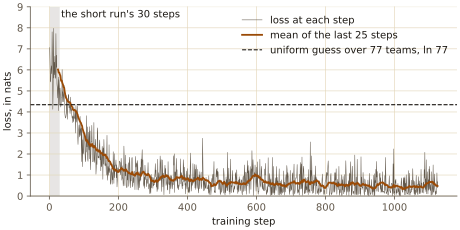

# Fine-tune a classification head with LoRA

By the end of this chapter, you can train a classification head on the labelled messages with LoRA, count the parameters that training changes, choose a hand-off threshold on the dev split by a stated rule, and record that threshold beside the results it produced.

The router so far runs the [stand-in](route-a-message#ask-a-model-for-one-team), which writes its answer as text in place of a hosted model, on a placeholder threshold, {{out:route-recorded-answers:placeholder threshold}}, that no one chose and every output labels as one. The answer has to be a team, and the threshold has to be chosen, so this chapter replaces that answer with a head that returns a team and a confidence in one forward pass, and it chooses the threshold on dev before any test result is reported. Training needs labelled messages for the router's teams, and these come from [BANKING77](measure-the-routing-task#the-data-and-its-licence), a public dataset. [Chapter 3](choose-a-base-model) chose SmolLM2-135M-Instruct as the base model, and this chapter fine-tunes that model and no other: the 360M stays a comparison, as chapter 3 said. The router is measured on the [samples](measure-the-routing-task#dev-test-and-fixed-samples) that chapter 2 fixed.

This chapter does not compare the adapter with the 360M, and it does not distill or quantize anything. Chapters 6, 7 and 9 distill, quantize and version the adapter.

## A head that scores the teams {#a-head-that-scores-the-teams}

The stand-in writes its answer as text, and a grammar limits that text to the 77 team names while it decodes ([chapter 4](prompt-and-constrain#a-token-trie-allows-only-team-names)). A classification head works differently from the stand-in: it keeps the language model's layers and adds one output layer with 77 outputs, one for each team. For each message, the model produces 77 scores. Softmax turns the scores into 77 probabilities that sum to one. The router returns the team with the highest probability, and the confidence is that probability.

The answer is an index into the 77 teams, so it is always one of them. [Chapter 4](prompt-and-constrain) reaches the same guarantee for a prompted model by constraining its text. This head never writes text, so it has nothing to constrain.

A message costs one forward pass: one run of the network from input to scores, with no loop that writes tokens one at a time. The team and the confidence come from that same pass. This matters for the hand-off. The flag that sends a message to a person is computed from the same probabilities as the team it protects, so the two cannot drift apart between two calls. A separate scoring call would need its own check that the two agree.

The confidence here has a narrower meaning than the stand-in's. In chapter 1, a confidence was the probability the stand-in's recorded answer had, which is not a softmax over teams. In this chapter, the confidence is the softmax probability of the chosen team. The two numbers are both called confidence, and both are compared with a threshold, but they are not the same quantity, so a threshold chosen for one is not a threshold for the other.

When two teams tie, `router_lib`'s `classify` function takes the lower label index. That follows from torch's `argmax`, whose documentation says: "If there are multiple maximal values then the indices of the first maximal value are returned." ([torch {{version:torch}} documentation](https://docs.pytorch.org/docs/2.15/generated/torch.argmax.html)). A fixed rule for ties keeps the output reproducible.

**Working rule:** Read the team and the confidence from one forward pass, and take the team as the output with the highest probability. Keep both in one function, so that a hand-off decision and the team it protects come from the same answer. Do not set a head's confidence beside a stand-in's as though they measured the same thing.

## Adapters train a small part of the model {#adapters-train-a-small-part-of-the-model}

Full fine-tuning changes every weight in the base model. LoRA takes a different route. The paper that introduced LoRA, [Hu et al. (2021)](https://arxiv.org/abs/2106.09685), says it freezes the pre-trained weights and injects trainable low-rank matrices into the layers of the Transformer, and the trained LoRA matrices are the adapter. The base model stays as it was, and the adapter is the part this book stores, loads and versions.

The rank, `r`, is the inner size of each added matrix, and it is kept small. Peft scales the added update by `lora_alpha` divided by `r` ([peft {{version:peft}}, `src/peft/tuners/lora/layer.py`](https://raw.githubusercontent.com/huggingface/peft/v0.21.2/src/peft/tuners/lora/layer.py), line 281: `self.scaling[adapter_name] = lora_alpha / r`), so `lora_alpha` sets how strongly the update counts. This book uses a rank of 8, with `lora_alpha` set to 16. The added matrices go in the projection layers named `q_proj` and `v_proj` in each attention block. The abstract does not name those layers, so this choice is the book's, not something the paper prescribes. We recommend it as a starting point, and the recorded adapter below is the test of that recommendation on this task. Other targets are a choice to measure, not a fact about the method.

The head is trained as well. Peft does that for this book's setup: a model built as a sequence classifier lists its `classifier` and `score` layers in `modules_to_save` ([peft {{version:peft}}, `src/peft/peft_model.py`](https://raw.githubusercontent.com/huggingface/peft/v0.21.2/src/peft/peft_model.py), line 1830: `classifier_module_names = ["classifier", "score"]`), so training moves the 77-output layer and the adapter together. Count only the adapter's matrices and you get a smaller number than the one the code trains, and the difference is the head. The next section's run counts the split from the loaded model: `{{out:lora-thirty-steps:LoRA parameters}}` in the adapter and `{{out:lora-thirty-steps:head parameters}}` in the head, which together make `{{out:lora-thirty-steps:trainable parameters}}`.

The adapter's manifest records the base model's revision, so a reader can check that revision against `models.toml` before scoring.

**Working rule:** Set the rank, the scaling and the target layers in one configuration, and count the trainable parameters from the loaded model before training starts. Print the total with the head in it. A count that leaves out the head reports part of what training changes, and it will not match what the optimizer updates.

## Thirty steps are not enough {#thirty-steps-are-not-enough}

Before the book uses a recording, it shows what a short run does with the same recipe. The run below takes {{out:lora-thirty-steps:training steps}} steps, at batch size {{out:lora-thirty-steps:batch size}} and seed {{out:lora-thirty-steps:seed}}, on the training rows outside dev, and then scores `test_200`, the first 200 entries of the [fixed sample](measure-the-routing-task#dev-test-and-fixed-samples) that chapter 2 drew. It is a failure, and the book shows it as one. The short run checks that the pipeline works from start to finish, and that is its only job here.

[Example: lora-thirty-steps](../examples/lora-thirty-steps.py)

Thirty steps are not enough to route with. The head this run trains gets {{out:lora-thirty-steps:accuracy on test_200}} right on `test_200`, and at the placeholder threshold it hands every message to a person: {{out:lora-thirty-steps:handed off at placeholder 0.50}}. A router that hands off every message gives no message to a team, so the labels it predicts never reach a caller. Because no message is kept, the accuracy on messages not handed off is not defined, as the output says.

The loss does not fall steadily across the three printed steps: it is {{out:lora-thirty-steps:loss at step 10}} at step 10, {{out:lora-thirty-steps:loss at step 20}} at step 20, and {{out:lora-thirty-steps:loss at step 30}} at step 30. Step 20 is higher than step 10, and step 30 is lower than step 20 but higher than step 10. Three points from 30 steps are not a learning curve. The loss at step 30 sits close to the uniform guess of {{out:lora-thirty-steps:loss of a uniform guess over 77 teams}}, so at that point the head is still close to chance. A uniform guess gives each team the same probability, one in 77, so its loss is the natural log of 77. The recording used in the section on the recorded adapter runs the same recipe for far more steps, and its accuracy is the one this book reports.

Scoring `test_200` here only reports the failure, and nothing is chosen from it: the recipe is fixed before the run, and the threshold is chosen later on dev. To see whether training works, read the loss and the dev measures, not the test sample, which is the rule chapter 2 set for every sample. Tuning a recipe against the test sample leaves no clean number to report, and the sample stops being a test.

**Working rule:** Run a short training to check that the pipeline works from start to finish, and do not route with its head. Judge a fine-tuned head on the dev split, with the measures set in chapter 2, after a run long enough to reach them. Do not read a loss curve of a few points as evidence that the head learns.

## Train on the training rows, never on the test rows {#train-on-the-training-rows-never-on-the-test-rows}

The training file holds labelled messages, and chapter 2 drew the dev split from it, team by team, with a fixed seed. Training uses the training rows that are not held back for dev. The test file is never read during training. The training order in [thirty steps are not enough](#thirty-steps-are-not-enough) is built from the rows left after dev is removed, shuffled with seed 0, so it is the same on every run.

The dev split carries the decisions. It holds {{out:choose-threshold-on-dev:dev messages}} messages from `train.csv`, the training file. No training step reads them, and they are used only to choose the threshold and to check the calibration in the last section.

The recipe is written into the adapter's manifest, so a reader can see what the adapter was trained on: the base model's pinned revision, the data commit, the batch size, the seed and the number of steps. Repeating the training takes those values, and checking that a result came from a clean split takes the data commit.

The rule matters most when a result looks good. A training run that reads the test sample has seen the messages it is then scored on, so its test accuracy measures nothing about new messages. Keeping dev and test apart is what makes the test accuracy in the next section a fair report.

**Working rule:** Train only on training rows that are outside dev. Record the seed, the batch size, the step count and the data commit in the manifest. When dev is too small to decide a threshold, draw more messages from the training file, never from the test file, as chapter 2 says.

## Use the recorded adapter {#use-the-recorded-adapter}

The working router uses `banking77-lora-v1`: the adapter from the full recorded run, version 1, written by `recordings/lora_full.py`. That script trained the adapter once, on the recipe in [the section on training rows](#train-on-the-training-rows-never-on-the-test-rows), and wrote its files and a manifest. The manifest holds the base model's revision, the data commit, the threshold, the recipe's hash and the hashes of the output files. Offline, the adapter loads and scores `test_200` at the threshold from its manifest, and nothing is trained.

The recording ends far below the uniform guess over 77 teams that [thirty steps are not enough](#thirty-steps-are-not-enough) compares the short run against: over its last hundred steps the mean loss is {{out:figure-lora-loss-curve:mean loss of the last 100 steps}}, against {{out:figure-lora-loss-curve:loss of a uniform guess over 77 teams}}. {{fig:lora-loss-curve}} draws the loss at every step of the recording, with its moving mean and the uniform guess. The thin line is the loss at each step, and the heavy line is the moving mean.

The shaded span on the left covers the short run's steps, and their mean loss is {{out:figure-lora-loss-curve:mean loss of the short run steps}}, above the guess. The moving mean last sits at or above the guess at step {{out:figure-lora-loss-curve:moving mean last at or above the guess, ending at step}}, and from step {{out:figure-lora-loss-curve:moving mean below the guess from step on}} to the last step it stays below the guess.

[Example: figure-lora-loss-curve](../examples/figure-lora-loss-curve.py)

The recording used seed {{out:figure-lora-loss-curve:recording seed}} and batch size {{out:figure-lora-loss-curve:recording batch size}}, the same as the short run's {{out:lora-thirty-steps:seed}} and {{out:lora-thirty-steps:batch size}}.

Take the adapter as it was recorded. A different recipe becomes a new run, named `v2`; the book does not edit the adapter by hand. Keeping the recording fixed is what lets a reader check the numbers in this chapter against the files they downloaded.

[Example: lora-recorded-adapter](../examples/lora-recorded-adapter.py)

The recorded adapter is right on {{out:lora-recorded-adapter:accuracy on test_200}} of the messages, against {{out:prompting-on-test-200:135m-raw correct}} for the prompted 135M model that [chapter 4](prompt-and-constrain) measured on the same 200. The 30-step run, at {{out:lora-thirty-steps:accuracy on test_200}}, falls below the prompted model. A handed-off message counts as wrong when its team is wrong. The output beside this paragraph gives the hand-off count and the accuracy on messages not handed off, each with its count and denominator, as chapter 2 requires.

The threshold is not chosen on this sample. It came from the manifest, which [the section on choosing the threshold](#choose-the-threshold-on-dev) explains. It is the threshold the recorded adapter's hand-off counts on `test_200` use: {{out:lora-recorded-adapter:handoff threshold from manifest}}. Reading it from the manifest keeps the choice on dev, where the rule made it.

The recorded adapter is the router's model, and the stand-in is the baseline. The two were measured with different thresholds, so their hand-off counts are not the same kind of result. Compare them on the same messages, with each threshold named beside its count. The comparison below does that for `test_200`, reading the stand-in's recorded answers for the same messages.

[Example: compare-with-standin](../examples/compare-with-standin.py)

Matching the two models message by message shows which messages each one misses. The stand-in's answers come from its recording, and the adapter runs live on the same 200 messages. The stand-in's confidence is the probability its recorded answer had, from the recording's log-probability. The stand-in's threshold is chapter 1's placeholder, {{out:compare-with-standin:stand-in placeholder threshold}}, and the output labels it as one. Its hand-off count, {{out:compare-with-standin:stand-in handed off}}, says what that placeholder does to the stand-in, and nothing about the stand-in's own threshold, which was never chosen on dev. The adapter hands off {{out:compare-with-standin:adapter handed off}} at {{out:compare-with-standin:adapter threshold from manifest}}.

The adapter is right on {{out:compare-with-standin:adapter banking77-lora-v1 correct}} of these messages, the stand-in on {{out:compare-with-standin:stand-in correct}}. Where the two disagree, the adapter alone is right on {{out:compare-with-standin:right for the adapter, wrong for the stand-in}}, and the stand-in alone on {{out:compare-with-standin:right for the stand-in, wrong for the adapter}}. Two accuracies can be equal while the two models miss different messages, and the disagreement counts show where that happens.

The comparison is one sample of 200 messages. [Chapter 1](route-a-message#score-the-router-on-a-fixed-sample) said that its small sample can show that a router fails, but cannot tell two routers apart with confidence. Chapter 1's sample was smaller. The discordant counts here, {{out:compare-with-standin:right for the adapter, wrong for the stand-in}} against {{out:compare-with-standin:right for the stand-in, wrong for the adapter}}, are stronger evidence than that sample could give. For a firmer claim, run the same comparison on the full `test_1001` sample, which the stand-in's recording also covers.

**Working rule:** Compare two models only on the same messages, and name the threshold each one used beside its count. When one threshold is a placeholder, say so beside its count, and do not read its hand-off count as the model's own result.

## Choose the threshold on dev {#choose-the-threshold-on-dev}

The threshold is the cut that sends a message to a person. Chapter 2 set its measures, and chapter 1 left it as a placeholder. The book's rule chooses it on the dev split only: the lowest confidence threshold, on a grid of 0.01, at which accuracy on messages not handed off is at least the target of {{out:choose-threshold-on-dev:target accuracy on messages not handed off}}. The rule is written in the manifest with its value, so a reader can see the rule as well as the number it produced. The test sample plays no part, [as chapter 2 requires](measure-the-routing-task#dev-test-and-fixed-samples).

[Example: choose-threshold-on-dev](../examples/choose-threshold-on-dev.py)

Scoring dev with the recorded adapter and applying the rule gives a threshold of {{out:choose-threshold-on-dev:chosen threshold}}. The check against the manifest's value prints {{out:choose-threshold-on-dev:chosen threshold matches manifest}}, and a mismatch would mean the manifest and the rule disagree.

Three thresholds show the trade-off, and the table below sets them side by side, with each count and rate. Raising the threshold never hands off fewer messages, and the rule picks the lowest value that meets the target. Each row is the same adapter on the same dev messages, so only the threshold changes.

| Threshold | Handed off, on dev | Accuracy on messages not handed off, on dev |
| --- | --- | --- |
| 0.50 | {{out:choose-threshold-on-dev:threshold 0.50 handed off}} | {{out:choose-threshold-on-dev:threshold 0.50 accuracy on messages not handed off}} |
| {{out:choose-threshold-on-dev:chosen threshold}}, chosen | {{out:choose-threshold-on-dev:threshold 0.63 handed off}} | {{out:choose-threshold-on-dev:threshold 0.63 accuracy on messages not handed off}} |
| 0.90 | {{out:choose-threshold-on-dev:threshold 0.90 handed off}} | {{out:choose-threshold-on-dev:threshold 0.90 accuracy on messages not handed off}} |

At 0.50, the router keeps more messages, but its kept messages are less accurate, and the target is missed. At 0.90, the kept messages are the most accurate of the three, but the most dev messages go to a person. The chosen value is the lowest of the three thresholds that meets the target, so it hands off more messages than 0.50 and fewer than 0.90. The table shows what it costs in hand-offs and what it buys in accuracy. Where to set the target is a business choice the rule cannot make. The book uses {{out:choose-threshold-on-dev:target accuracy on messages not handed off}} accuracy on kept messages, and a bank running its own router would read its own target off this trade.

The adapter stays the same in production, but the messages it sees do not. Suppose a product problem sends many messages about one team in one week. The threshold was chosen on the dev mix of messages, so the hand-off rate can move on its own while the adapter stays exactly the same. A rise in hand-offs with no change to the adapter is the sign to check the mix of messages first. Moving the threshold by eye until the hand-off rate looks right gives up the property the rule was chosen for: at least the target accuracy on the dev messages the router keeps.

The confidence is not a probability that the team is right. [Guo et al. (2017)](https://arxiv.org/abs/1706.04599) report that their networks are "poorly calibrated", meaning their confidence does not match how often they are right. This book checks its own adapter on dev. The dev messages fall into five confidence bands, and each band gets a count, an accuracy and a mean confidence, the two quantities Guo et al. compare when they measure calibration. Grouping dev by confidence shows whether a 0.9 means nine in ten.

[Example: calibration-bands-on-dev](../examples/calibration-bands-on-dev.py)

Most dev messages fall in the top band, from 0.8 to 1.0, which holds {{out:calibration-bands-on-dev:band 0.8-1.0 messages}} of them. The bottom band, from 0.0 to 0.2, holds {{out:calibration-bands-on-dev:band 0.0-0.2 messages}}, too few for its accuracy to say anything about low confidence.

On dev the confidence orders the messages usefully, but at the top it runs above the accuracy: the top band's mean confidence is {{out:calibration-bands-on-dev:band 0.8-1.0 mean confidence}}, against an accuracy of {{out:calibration-bands-on-dev:band 0.8-1.0 correct}}. Four of the five bands have an accuracy inside their range, and the bottom band is the one exception, with its single message. From the second band up, accuracy rises. In the two middle bands, accuracy and mean confidence sit close together, while in the band from 0.2 to 0.4 the mean confidence is well above the accuracy.

The bands cannot show more: the band from 0.2 to 0.4 holds {{out:calibration-bands-on-dev:band 0.2-0.4 messages}} messages. Every number here comes from the one dev sample that also chose the threshold, so none of them shows how calibrated the adapter will be on new messages.

The router the rule chooses is an empirical cut on dev, recorded with its rule and data. It is a cut, not a model of the messages, so its numbers describe the dev mix. A reader takes its hand-off rate and accuracy on kept messages as the router's result, and re-checks the dev rule when the mix of messages moves.

**Working rule:** Choose the threshold on the dev split by the stated rule, and write its value and the rule into the adapter's manifest. Report the hand-off rate beside accuracy on the messages kept, each with its count, and show at least one setting either side of the chosen value. Check calibration on dev before you trust the confidence as a cut, and when the mix of messages changes, choose the threshold again on a fresh dev draw from the training file.
